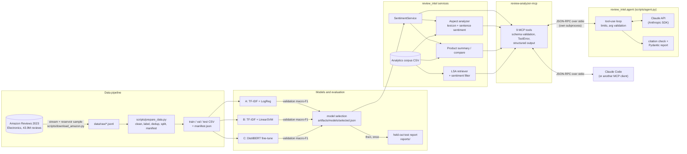

# Review Analyzer

**NLP/ML system for analyzing Amazon Electronics customer reviews, with an MCP server that exposes the trained model and the analytics as tools, and a Claude-based agent that uses those tools to write evidence-checked reports.**

It covers the whole path from raw data to a usable service: a reproducible data pipeline, three sentiment classifiers compared under one protocol (TF-IDF + Logistic Regression, TF-IDF + Linear SVM, fine-tuned DistilBERT), held-out evaluation, product-level analytics with evidence, similar-review retrieval, a typed, read-only MCP integration layer, and an LLM agent (Claude API + its own MCP client and tool-use loop) whose report citations are checked against the actual tool results.

| | |
|---|---|
| **Selected model** | DistilBERT fine-tuned on 77,268 reviews: test accuracy **0.8927**, macro-F1 **0.7522** (n = 9,659) |
| **Data** | Amazon Reviews 2023, Electronics: a uniform random sample of 100,000 reviews out of 43.9M, plus a separate 49,958-review corpus of 50 products |
| **Interface** | 9 MCP tools over stdio (sentiment, statistics, keyword and similar-review search, product summaries, comparisons, negative aspects, model info) |
| **Agent** | `scripts/agent.py`: question → Claude chooses tools → MCP server → bounded loop → Pydantic-validated report with checked review-id citations |
| **Status** | Research/portfolio project, run locally. Not deployed as a production service. |

---

## Contents

1. [Problem](#problem)
2. [Capabilities](#capabilities)
3. [Architecture](#architecture)
4. [Repository structure](#repository-structure)
5. [Data](#data)
6. [Models](#models)
7. [Training and evaluation methodology](#training-and-evaluation-methodology)
8. [Results](#results)
9. [Sentiment labels vs star ratings](#sentiment-labels-vs-star-ratings)
10. [Similar-review search](#similar-review-search)
11. [MCP server and its nine tools](#mcp-server-and-its-nine-tools)
12. [Installation](#installation)
13. [Getting the data and models](#getting-the-data-and-models)
14. [Configuration](#configuration)
15. [Running the tests](#running-the-tests)
16. [Using the MCP server in Claude Code](#using-the-mcp-server-in-claude-code)
17. [Example usage](#example-usage)
18. [LLM agent: Claude over the MCP server](#llm-agent-claude-over-the-mcp-server)
19. [Limitations and future work](#limitations-and-future-work)
20. [Reproducibility](#reproducibility)
21. [Technology stack](#technology-stack)
22. [Licensing and acknowledgements](#licensing-and-acknowledgements)
23. [License](#license)

---

## Problem

Product reviews are abundant, unstructured and noisy. A product team wants to know (a) whether a review is positive, neutral or negative, and (b) **which aspects** of a product drive complaints, with evidence, without reading thousands of reviews. Doing this credibly requires more than a classifier: clean data without leakage, an honest evaluation on held-out data, analytics that report their sample sizes, and an interface that other tools (here, an LLM assistant) can call safely.

## Capabilities

| Capability | Implementation | Status |
|---|---|---|
| Streaming sampler for the 22.6 GB Amazon review file (uniform reservoir sample) | `src/review_intel/data/amazon.py` | executed |
| Resumable per-product collection (byte-range chunks, order-independent bottom-k sampling) | `src/review_intel/data/product_collection.py` | executed |
| Dataset pipeline: cleaning, star-rating labels, de-duplication, stratified split, manifest with leakage checks | `src/review_intel/data/pipeline.py` | executed |
| Sentiment models A/B/C behind one interface | `src/review_intel/models/` | trained and evaluated |
| Validation-based model selection, single held-out test evaluation, calibration (ECE), latency | `src/review_intel/evaluation/` | executed |
| Inference service: input validation, explicit score types, no silent fallback | `src/review_intel/inference/service.py` | used by MCP |
| Product statistics, summaries with 95% Wilson intervals, comparisons, negative aspects | `src/review_intel/analytics/` | implemented, descriptive only |
| Similar-review search: LSA (TF-IDF + truncated SVD) with an optional sentiment filter | `src/review_intel/retrieval/semantic.py` | implemented |
| Optional dense retriever (sentence-transformers) | same file | implemented and unit-tested; **not run on real data** |
| MCP server with 9 typed, read-only tools | `review-analyzer-mcp/server.py` | verified over stdio |
| LLM agent: MCP client, explicit tool-use loop over the Claude API, limits, citation check, run traces | `src/review_intel/agent/`, `scripts/agent.py` | offline-tested with a scripted model and the real MCP server; **no live Claude run recorded in this repository yet** |
| Agent evaluation set (6 cases incl. insufficient evidence and prompt injection) | `data/eval/agent_cases.jsonl`, `scripts/eval_agent.py` | harness tested offline; **live results not yet recorded** |
| Aspect-level accuracy, confidence intervals for model metrics | none | **not done**: no gold aspect labels; single split |

## Architecture



The ML code (`src/review_intel`) does not depend on MCP. The MCP server is a thin layer that validates arguments, calls the package and labels where every value comes from. The agent is a separate MCP *client*: it knows the server only through the tools it discovers.

## Repository structure

```
review-analyzer/
├── README.md                    # this file
├── pyproject.toml               # package "review-intel" + extras [mcp] [transformer] [semantic] [data] [dev]
├── requirements-lock.txt        # exact versions of the environment that produced the results (Windows, CUDA 12.8)
├── configs/
│   ├── data/                    # dataset configs: column mapping, label source, split, seed
│   ├── models/                  # baseline grids, DistilBERT training config
│   └── aspects.json             # aspect lexicon (configuration, not a trained model)
├── src/review_intel/
│   ├── data/                    # amazon.py (sampler), product_collection.py, labels.py, pipeline.py
│   ├── preprocessing/text.py    # stateless cleaning, star-title removal, sentence split
│   ├── models/                  # common interface, sklearn models, DistilBERT, training, artifacts
│   ├── evaluation/              # metrics, calibration, latency, selection + test protocol
│   ├── inference/service.py     # SentimentService (independent of MCP)
│   ├── analytics/               # corpus loading, aspects, statistics, summaries, comparisons
│   ├── retrieval/semantic.py    # LSA + optional dense retriever + sentiment filter
│   ├── agent/                   # LLM agent: config, Claude adapter, MCP client, loop, guards, citation check, trace
│   └── app.py                   # facade used by the MCP server
├── configs/agent/system_prompt.md  # the agent's versioned system prompt
├── scripts/                     # command-line entry points (pipeline stages, agent.py, eval_agent.py)
├── review-analyzer-mcp/         # MCP server, its README and its tests
├── tests/                       # tests for the ML/data package and the agent (test_agent*.py)
├── data/eval/agent_cases.jsonl  # agent evaluation questions
├── reports/amazon_electronics/  # machine-generated validation and test reports (JSON + Markdown)
├── docs/                        # methodology, full results, experiment log template
└── data/
    ├── fixtures/                # synthetic reviews used by the tests (73 for ML, 10 for the agent)
    └── processed/*/manifest.json  # dataset manifests (the data files themselves are not committed)
```

Not in the repository (git-ignored, rebuilt by the scripts): `data/raw/`, the processed CSV files and `artifacts/` (trained models, about 285 MB). See [Getting the data and models](#getting-the-data-and-models).

## Data

**Source:** [Amazon Reviews 2023](https://amazon-reviews-2023.github.io/) (McAuley Lab, UC San Diego; Hou et al., 2024, arXiv:2403.03952), category Electronics. The streaming pass counted 43,886,944 review lines.

**Research corpus (training and evaluation).** The file is ordered by user, so taking its first lines would be biased. `scripts/download_amazon.py` streams the whole file once and keeps a uniform random sample of 100,000 reviews (reservoir sampling, seed 42). After cleaning and de-duplication, 96,586 remain:

| Split | Reviews | Negative | Neutral | Positive |
|---|---|---|---|---|
| train | 77,268 | 18.06% | 6.80% | 75.14% |
| validation | 9,659 | 18.07% | 6.80% | 75.13% |
| test | 9,659 | 18.06% | 6.80% | 75.14% |

Excluded during cleaning (counted in `data/processed/amazon_electronics/manifest.json`): 113 empty or too-short texts, 2,145 duplicate texts, 1,156 copies of texts whose duplicates carried conflicting labels. Text overlap between splits is 0.

**Analytics corpora (used only by the MCP tools, never for training).**

| Corpus | File | Contents | Use |
|---|---|---|---|
| Original (default) | `data/processed/amazon_electronics/analytics_corpus.csv` | The 9,659-review held-out **test split**; 8,177 products, 7,369 of them with a single review; titles for 25 products | Corpus-level statistics and search |
| Per-product | `data/processed/amazon_electronics_products/corpus.csv` | **49,958 reviews** for the 50 most-reviewed products (996–1,000 each), official titles for all 50; no review from the research sample | Product summaries and comparisons |

The per-product corpus was read from the official Hugging Face mirror of the same file (pinned commit `2b6d039e…`). 1,000 reviews per product is a uniform random sample of each product's reviews (bottom-k by `sha1(seed | review key)`), not all of them. Its label distribution is 80.54% positive, 13.08% negative, 6.38% neutral. Provenance and checks: [methodology §2.2](docs/research_methodology.md#22-per-product-analytics-corpus-collected-2026-10-15) and `data/processed/amazon_electronics_products/validation_report.json`.

**Limitations of the data:** English only, one category, one platform; labels come from star ratings, not human sentiment annotation; popular products appear in several splits (reported in the manifest), so generalization to unseen products is not measured.

## Models

All models implement one interface (`SentimentModel` in `src/review_intel/models/base.py`) and return a label plus scores whose type is stated explicitly.

| Model | Features | Classifier | Scores |
|---|---|---|---|
| **A** TF-IDF + Logistic Regression | word 1–2-grams + character 3–5-grams (`char_wb`), sublinear TF | `LogisticRegression` (lbfgs), C = 0.5, balanced class weights | probabilities |
| **B** TF-IDF + Linear SVM | same feature union | `LinearSVC`, C = 0.05, balanced class weights | decision scores (**not** probabilities) |
| **C** DistilBERT | WordPiece tokens, max length 256 | `distilbert/distilbert-base-uncased` + classification head, fine-tuned end to end | softmax probabilities |
| Reference | keyword counts | none (the original v1 demo) | keyword counts; used only when explicitly configured |

DistilBERT training (`src/review_intel/models/transformer.py`, plain PyTorch loop): AdamW (lr 5e-5, weight decay 0.01), linear warmup (6%) and decay, class-weighted cross-entropy, gradient clipping at 1.0, batch 32, 2 epochs, bf16 autocast on an RTX 5060. The best epoch by validation macro-F1 is saved (epoch 2; training took 572 s).

## Training and evaluation methodology

1. **Split once:** stratified 80/10/10, seed 42, after de-duplication (so no text appears in two splits).
2. **Tune on validation only:** grids over feature sets, C and class weights for A and B; best epoch for C. The criterion is **macro-F1**, because 75% of reviews are positive and accuracy would reward ignoring the minority classes.
3. **Select across families on validation:** DistilBERT 0.7444, LogReg 0.6966, SVM 0.6920. The selection is written to `reports/amazon_electronics/model_selection.json`.
4. **Open the test set once:** `scripts/evaluate_models.py test` refuses to run before a selection is recorded. The other two models were evaluated on test afterwards for comparison only.

Learned preprocessing (TF-IDF vocabulary and IDF) is fitted on the training split only, and a unit test checks that training code never reads the test split. Full method: [`docs/research_methodology.md`](docs/research_methodology.md).

## Results

Held-out test set, n = 9,659 (`reports/amazon_electronics/test_report.md`):

| Model | Accuracy | Macro-F1 | F1 negative | F1 neutral | F1 positive | ECE | Train time | Median latency (1 text) |
|---|---|---|---|---|---|---|---|---|
| **DistilBERT** (selected) | **0.8927** | **0.7522** | 0.8493 | 0.4513 | 0.9559 | 0.0324 | 572 s (GPU) | 3.44 ms (GPU) |
| TF-IDF + LinearSVM | 0.8833 | 0.7021 | 0.8134 | 0.3453 | 0.9477 | n/a | 29 s | 1.08 ms |
| TF-IDF + LogReg | 0.8521 | 0.7009 | 0.7926 | 0.3802 | 0.9299 | 0.0423 | 52 s | 1.08 ms |

DistilBERT confusion matrix on test (rows = true label):

| true \ predicted | negative | neutral | positive |
|---|---|---|---|
| negative (1,744) | 1,494 | 223 | 27 |
| neutral (657) | 190 | 378 | 89 |
| positive (7,258) | 90 | 417 | 6,751 |

How to read these numbers:
- DistilBERT is about 5 macro-F1 points better than both linear models. That is one split and one seed, with no significance test.
- **Neutral is the weak class for every model** (F1 0.35–0.45). Only 6.8% of reviews are 3-star, and a 3-star rating is a noisy label for the sentiment of the text. The confusion matrix shows neutral errors going in both directions.
- The SVM has higher accuracy than LogReg but lower macro-recall, because it favors the majority class. This is why macro-F1, not accuracy, is the selection metric.
- These metrics measure agreement with **star-rating labels**, not with human judgments of the text.

All numbers were checked against the JSON reports on 2026-10-16. The recorded model version is `distilbert@amazon_electronics-20261014-79b5c36e`. The validation macro-F1 logged during training (0.7441, bf16 autocast) differs from the reported 0.7444 (the saved artifact re-evaluated in fp32); the difference is numerical. Validation tables, grids and latency method: [`docs/experiment_results.md`](docs/experiment_results.md).

## Sentiment labels vs star ratings

Labels are derived from star ratings with a fixed rule (`src/review_intel/data/labels.py`): **1–2 stars → negative, 3 → neutral, 4–5 → positive**. Fractional or missing ratings are excluded, not rounded. Auto-generated titles such as "Five Stars" are removed from the text because they would leak the label.

A star rating is a proxy: a 4-star review can complain about the battery, and a 3-star review can read as clearly positive. The project therefore keeps two sources of sentiment strictly separate, and every MCP response names its source in a `sentiment_sources` field:

| Source | Meaning | Used by |
|---|---|---|
| `star_rating_label` | The stored label derived from the customer's rating (verified against the rating for every review) | `get_review_statistics`, `search_reviews`, `search_similar_reviews` (`sentiment`), sentiment distributions in summaries and comparisons |
| `model_prediction` | DistilBERT's prediction for the text, with the model version | `analyze_sentiment`, `get_negative_aspects`, aspect sentiment, `predicted_sentiment` in filtered similar-review search |

## Similar-review search

`search_similar_reviews` ranks reviews by **cosine similarity of LSA vectors**: TF-IDF over word 1–2-grams (English stop words removed), reduced to 200 dimensions with truncated SVD (`LsaRetriever`). LSA captures co-occurrence ("drains" near "battery life"); it is **lexical-topical similarity, not semantic understanding**, and it ignores negation and polarity.

Measured on the per-product corpus (2026-10-16): for *"The battery drains too quickly."* the top unfiltered hit (similarity 0.967) is a short review praising the battery, the opposite of the query (illustration, not the original text: [Synthetic review: "The battery runs for ages between charges."]), and 4 of the top 5 results are 5-star reviews.

The optional sentiment filter does not change the ranking. It only removes reviews whose sentiment does not match:

| `sentiment_source` | Filters on | Candidates |
|---|---|---|
| `star_rating_label` | the stored star-rating label | the whole ranking (exact top-`limit`) |
| `model_prediction` | DistilBERT's prediction for the review text | only the `candidate_pool` most similar reviews (default 200, max 1,000), because classifying the whole corpus per query is too slow |

With `model_prediction`, fewer results than `limit` means the pool held fewer matches, not that the corpus has none. In the run above, 44 of the 200 candidates were predicted negative, including a 4-star review whose text complains about battery life. A filter without an explicit source is rejected with a validation error.

## MCP server and its nine tools

[MCP (Model Context Protocol)](https://modelcontextprotocol.io/) is a protocol for an AI application to discover and call external tools. It is **not** a model and does no NLP itself. Here, Claude Code launches `review-analyzer-mcp/server.py` as a subprocess and exchanges JSON-RPC messages over stdin/stdout. The server declares typed tools; arguments are validated against JSON Schema (pydantic) before any Python code runs, and expected failures return a readable `isError: true` result.

| Tool | Arguments (defaults) | Returns |
|---|---|---|
| `analyze_sentiment` | `text` | label, class scores, score type, model version |
| `get_review_statistics` | `product=""` | counts and percentages per label, average rating |
| `search_reviews` | `keyword`, `product=""`, `limit=20` | reviews containing the keyword, total match count |
| `list_products` | `limit=20` | products by review count, plus corpus coverage |
| `get_product_summary` | `product` | counts, rating and sentiment distribution with 95% Wilson intervals, sample-size check, top and most-negative aspects, representative reviews |
| `get_negative_aspects` | `product=""`, `limit=5` | aspects ranked by negatively classified mentions, with excerpts |
| `compare_products` | `product_a`, `product_b` | side-by-side statistics, differences, shared aspects, `comparison_reliable` |
| `search_similar_reviews` | `query`, `product=""`, `limit=5`, `sentiment_filter="any"`, `sentiment_source=""`, `candidate_pool=200` | reviews ranked by LSA cosine similarity, optionally filtered by sentiment |
| `get_model_info` | none | active model, validation and test metrics, corpus, retriever, lexicon |

All tools are read-only. There are no file, shell or network tools. Full schemas, example responses, performance notes and troubleshooting: [`review-analyzer-mcp/README.md`](review-analyzer-mcp/README.md).

## Installation

Requires Python 3.11+ (developed and tested on Python 3.12.10, Windows 11).

**Windows (PowerShell)**

```powershell
git clone https://github.com/alisherizmukhan/review-analyzer.git
cd review-analyzer
python -m venv .venv
.\.venv\Scripts\Activate.ps1
python -m pip install --upgrade pip
pip install -e ".[mcp,dev]"          # core ML package + MCP server + pytest
pip install -e ".[mcp,agent,dev]"    # ... plus the LLM agent (Anthropic SDK, jsonschema)
```

To train or serve DistilBERT, install PyTorch first from the index that matches your hardware, then the transformer extra:

```powershell
pip install torch --index-url https://download.pytorch.org/whl/cu128   # NVIDIA GPU (CUDA 12.8)
# or: pip install torch --index-url https://download.pytorch.org/whl/cpu
pip install -e ".[transformer]"
```

**Linux / macOS (not tested in this project)**

```bash
python3 -m venv .venv
source .venv/bin/activate
pip install -e ".[mcp,dev]"
pip install torch && pip install -e ".[transformer]"
```

The code uses `pathlib` throughout and resolves all configured paths from the project root, so no path changes should be needed. `requirements-lock.txt` pins the exact Windows/CUDA environment used for the reported results.

## Getting the data and models

The repository does **not** include the review data or the trained model weights:
- **Data:** the Amazon Reviews 2023 pages do not state a licence, so raw and processed reviews are not redistributed. Only manifests (counts, SHA-256 hashes, configuration) and aggregate reports are committed.
- **Models:** the artifacts total about 285 MB (DistilBERT `model.safetensors` alone is 268 MB, over GitHub's 100 MB file limit) and are derived from that data.

Without them you can still run the full test suite (it uses the synthetic fixture) and the MCP server in demo mode (`REVIEW_ANALYZER_DATA=demo`, `REVIEW_ANALYZER_SENTIMENT_BACKEND=keyword`).

To rebuild everything (commands run from the project root; the first step streams about 6.5 GB):

```powershell
# 1. Data: uniform sample of 100,000 reviews, then clean/label/split
python scripts/download_amazon.py --category Electronics --sample-size 100000 --top-products 0 --seed 42
python scripts/prepare_data.py --config configs/data/amazon_electronics.json

# 2. Models: baselines (minutes on CPU), DistilBERT (about 10 minutes on an RTX 5060; much longer on CPU)
python scripts/train_baselines.py --data data/processed/amazon_electronics
python scripts/train_transformer.py --data data/processed/amazon_electronics

# 3. Select on validation and activate for serving, then evaluate on test once
python scripts/evaluate_models.py compare --data data/processed/amazon_electronics --activate
python scripts/evaluate_models.py test --data data/processed/amazon_electronics --all

# 4. Analytics corpora
pip install -e ".[data]"
python scripts/fetch_product_titles.py --from-csv data/processed/amazon_electronics/test.csv --top 25 --out data/raw/amazon_electronics/product_metadata.json
python scripts/build_corpus.py --split data/processed/amazon_electronics/test.csv --names data/raw/amazon_electronics/product_metadata.json --out data/processed/amazon_electronics/analytics_corpus.csv
python scripts/download_amazon.py --products-only --category Electronics --top-from-sample 50 --per-product-cap 1000 --seed 42
python scripts/fetch_product_titles.py --asin-file data/raw/amazon_electronics_products/selected_products.json --out data/raw/amazon_electronics_products/product_metadata.json
python scripts/prepare_data.py --config configs/data/amazon_electronics_products.json
python scripts/validate_product_corpus.py --verify-source 200
```

Compare the `source.sha256` in the new `manifest.json` with the committed one to confirm you have the same sample. A rerun should reproduce the dataset exactly; DistilBERT metrics can differ slightly because GPU kernels are not forced to be deterministic. Expected locations: models in `artifacts/models/amazon_electronics/<family>/`, the active model pointer in `artifacts/models/selected.json`.

## Configuration

The application reads optional environment variables from the process environment (no `.env` file is loaded). Relative paths resolve from the project root.

| Variable | Default | Meaning |
|---|---|---|
| `REVIEW_ANALYZER_DATA` | `data/processed/amazon_electronics/analytics_corpus.csv` | Review corpus (`.csv` or `.json`); `demo` selects the 5-review synthetic file |
| `REVIEW_ANALYZER_SENTIMENT_BACKEND` | `trained` | `trained`, or `keyword` for the explicit demo baseline |
| `REVIEW_ANALYZER_MODEL_DIR` | from `artifacts/models/selected.json` | Serve a specific model artifact |
| `REVIEW_ANALYZER_MAX_TEXT_CHARS` | `5000` | Maximum `analyze_sentiment` input length |
| `REVIEW_ANALYZER_MIN_PRODUCT_REVIEWS` | `30` | Reviews below which a product summary is flagged as a small sample (a heuristic) |
| `REVIEW_ANALYZER_RETRIEVER` | `lsa` | `lsa`, or `sentence-transformers` (needs `.[semantic]`) |
| `REVIEW_ANALYZER_EMBEDDING_MODEL` | `sentence-transformers/all-MiniLM-L6-v2` | Model for the dense retriever |
| `REVIEW_ANALYZER_ASPECTS` | `configs/aspects.json` | Aspect lexicon |

The ML package and the MCP server need no API keys or credentials. Only the LLM agent does (`ANTHROPIC_API_KEY`); its settings are listed in [LLM agent → Configuration and limits](#configuration-and-limits).

## Running the tests

```powershell
python -m pytest                              # everything: ML package + MCP server + agent (offline)
python -m pytest review-analyzer-mcp/tests    # MCP layer only
python -m pytest tests/test_agent.py          # agent only (scripted model; no API key, no network)
```

Last run: see [LLM agent → Tests](#tests) for the current count. Before the agent was added (2026-10-16, Windows 11, Python 3.12.10, PyTorch installed): **219 passed**. The tests are offline: they build their own data from `data/fixtures/synthetic_reviews.csv`, train small models on it, use a tiny randomly initialized transformer (no download) and start the MCP server as a real stdio subprocess. The transformer test is skipped if PyTorch is not installed. Passing tests show that the code behaves as specified; they do not re-measure model quality on real data.

## Using the MCP server in Claude Code

Register the server once (PowerShell, from the project root; `-s user` makes it available in every project):

```powershell
claude mcp add review-analyzer -s user `
  -e REVIEW_ANALYZER_DATA="$PWD\data\processed\amazon_electronics_products\corpus.csv" `
  -- "$PWD\.venv\Scripts\python.exe" "$PWD\review-analyzer-mcp\server.py"
```

- Use the **absolute path of the virtual environment's Python**. Claude Code starts the process itself, without your activated shell, so a bare `python` may resolve to another interpreter that cannot import `review_intel`.
- Check the connection with `/mcp` inside Claude Code, or `claude mcp list`.
- The server loads DistilBERT before answering the handshake (8.5 s warm on the development machine; a cold start can approach 30 s). If it times out, start Claude Code with `$env:MCP_TIMEOUT = "120000"`.
- After moving the project folder, re-run `pip install -e .` and update the registered paths (`claude mcp remove review-analyzer -s user`, then add it again).

Without trained artifacts, register it with `-e REVIEW_ANALYZER_DATA=demo -e REVIEW_ANALYZER_SENTIMENT_BACKEND=keyword` to try the tools on the synthetic demo data.

## Example usage

**Standalone prediction (no MCP):**

```powershell
python scripts/predict.py "The remote stopped working after two weeks."
```

**In Claude Code**, natural-language requests map to tool calls, for example:

- *"Which aspects of the Fire TV Stick (B075X8471B) do customers complain about? Show evidence and the sample size."* → `get_negative_aspects`
- *"Find complaints similar to 'the battery drains too quickly', using the model's predictions."* → `search_similar_reviews` with `sentiment_filter="negative"`, `sentiment_source="model_prediction"`

A real `search_similar_reviews` result (per-product corpus, abbreviated). Review texts in this example are synthetic placeholders written for this documentation (labelled `[Synthetic example]`); the original Amazon review texts are not reproduced. All other values (ids, ratings, scores, similarities, counts) are from the real response and were computed on the original texts.

```json
{
  "method": "lsa (tf-idf + truncated SVD, 200 dims, cosine)",
  "sentiment_filter": {"sentiment": "negative", "source": "model_prediction",
                       "model_version": "distilbert@amazon_electronics-20261014-79b5c36e",
                       "candidate_pool": 200, "candidates_scanned": 200, "candidates_matching": 44},
  "results": [
    {"text": "[Synthetic example] Weak battery: it needs charging far more often than advertised. …", "rating": 2,
     "similarity": 0.8902, "sentiment": "negative", "predicted_sentiment": "negative", "predicted_score": 0.922163},
    {"text": "[Synthetic example] Nice screen, but I keep having to recharge it every couple of days. …", "rating": 4,
     "similarity": 0.8631, "sentiment": "positive", "predicted_sentiment": "negative", "predicted_score": 0.866549}
  ]
}
```

More real responses for every tool: [`review-analyzer-mcp/README.md`](review-analyzer-mcp/README.md#example-calls-real-responses-abbreviated-with-).

## LLM agent: Claude over the MCP server

Claude Code can call the MCP tools, but then Claude Code is the agent. `src/review_intel/agent` is a separate, small agent with its **own** MCP client and an explicit tool-use loop over the Claude API:

```
question ─► Claude (Messages API) ──tool_use──► agent loop ──validate args──► MCP client ──stdio──► server.py
               ▲                                    │                                                  │
               └──── tool_result (bounded, fenced as untrusted data) ◄─────────── structured result ◄──┘
               │
               └─ final JSON (structured output) ─► Pydantic ReportDraft ─► citation check ─► AgentReport
```

| Module | Responsibility |
|---|---|
| `agent/toolbox.py` | Starts `server.py` as a subprocess (stdio), discovers the tools with `tools/list`, exposes only tools annotated read-only, validates arguments against each tool's JSON Schema, calls tools with a timeout, closes the session and the subprocess on exit (also on errors). The child process gets a minimal environment: never `ANTHROPIC_*` |
| `agent/llm.py` | `LLMClient` interface + `AnthropicLLM` (official `anthropic` SDK): tool definitions taken from the discovered MCP tools, structured output (`output_config.format`) for the final report, prompt caching, server-side refusal fallback, its own retry loop (counted and traced) |
| `agent/loop.py` | `ReviewAgent`: the model picks tools; the loop executes them through MCP and returns all results of a turn in one message; enforces turn, tool-call, duplicate-call and token limits |
| `agent/guard.py` | Bounds each tool result (structurally: shortens texts, then trims ranked lists; ids, labels, ratings and counts are never altered) and fences it as untrusted data |
| `agent/evidence.py`, `agent/report.py` | Indexes what the model actually saw; checks every cited review id, quoted excerpt and number against it; builds the Pydantic `AgentReport` |
| `agent/trace.py` | One JSONL trace per run (`runs/agent/`), secrets redacted, no review text |
| `configs/agent/system_prompt.md` | Versioned system prompt (workflow, untrusted-data rule, evidence rules) |

### Prerequisites and setup

- Everything from [Installation](#installation), plus the agent extra: `pip install -e ".[mcp,agent,dev]"`.
- An Anthropic API key, provided **only** through the environment. The SDK reads `ANTHROPIC_API_KEY`; the code never reads, prints or logs it, and does not pass it to the MCP server process.

  ```powershell
  $env:ANTHROPIC_API_KEY = "<your key>"     # current shell only; do not put it in any file in this repository
  ```
- Real-data questions need the trained model and the per-product corpus (see [Getting the data and models](#getting-the-data-and-models)). Without them, use `--corpus demo` or the synthetic fixture `--corpus data/fixtures/agent_reviews.json` with `$env:REVIEW_ANALYZER_SENTIMENT_BACKEND = "keyword"`.

### Running the agent

```powershell
python scripts/agent.py --corpus products "What do customers complain about for the Echo Auto (B07VTK654B)?"
python scripts/agent.py --corpus products "Compare complaints about B08F6GPRH6 and B00N2ZDXW2"
python scripts/agent.py --corpus products --json "Is there evidence that the TOZO T10 (B08XPWDSWW) charging case fails?"
python scripts/agent.py --corpus products -v --max-tool-calls 4 --model claude-sonnet-5-5 "..."
```

`--corpus` takes `products`, `analytics`, `demo` or a path. `--json` prints the full validated report. `-v` logs every model and tool call to stderr. Exit codes: 0 report, 1 run ended without a valid report (the reason is printed, e.g. `limit_turns`, `refusal`, `llm_error`), 2 configuration problem (missing key or package).

The agent starts its **own** server subprocess for each run. An MCP stdio connection is a private pipe, so it cannot share the copy Claude Code may be running. Expect the first `search_similar_reviews` of a run on the per-product corpus to take about 47–56 s (the LSA index is built; measured 2026-10-17/18); the default tool timeout is 180 s.

### Example output

The run below is **not a Claude response**. It is the real output of the CLI renderer for a run in which a *scripted test model* drove the real MCP server on the synthetic fixture (`data/fixtures/agent_reviews.json`, keyword baseline). It shows the report format and the citation check. The scripted model deliberately cited review 777 (which does not exist) and review 102 (which exists in the corpus but was not returned by any tool in this run); both were rejected:

```text
Key findings
  - [verified] 2 reviews complain that the battery drains quickly. (reviews 101, 104)
  - [UNSUPPORTED] One review reports Bluetooth dropouts.
  - [interpretation] Battery capacity may be the main driver of returns. (reviews 104)
...
Citation check: 2 review ids verified, 2 rejected, 0 unverified numbers (2 reviews seen in tool results).
  rejected: review 102 at key_findings[1]: review id does not occur in any tool result seen in this run
  rejected: review 777 at key_findings[1]: review id does not occur in any tool result seen in this run
```

No live Claude run has been recorded in this repository yet. Once you run one, the trace in `runs/agent/` holds the measured tokens, latency and cost.

### Report and citation check

The final answer must be JSON that matches `ReportDraft` (sent as the structured-output schema, then validated again with Pydantic). It contains: query, executive summary, key findings (each labelled `retrieved_fact` or `interpretation`), statistics, negative aspects, supporting review ids, evidence excerpts, limitations and an `insufficient_evidence` flag. A report that fails validation gets one repair turn; a second failure ends the run (`invalid_output`).

`finalize()` then checks the draft against the tool results **the model actually received** (after truncation):
- a cited review id must occur in a review record of some tool result; otherwise it is removed and listed under `validation.rejected_citations`;
- an evidence excerpt must occur in the text returned for that review (ellipses allowed);
- numbers in statistics, aspects and finding statements must match a number in the tool results (rounding and fraction↔percent tolerated). This is a heuristic that catches invented numbers, not every misattribution;
- each finding gets a support level: `verified`, `partially_verified`, `unsupported` or `interpretation`.

`AgentReport` refuses to validate if any remaining citation is outside the verified set, so an unchecked id cannot reach the output.

### Safety constraints and execution limits

| Control | Default | Behaviour at the limit |
|---|---|---|
| Model turns per run (`--max-turns`) | 8 | `AgentError(limit_turns)` |
| Tool executions per run (`--max-tool-calls`) | 12 | extra calls in that turn are not executed; the model is told to write the report; any further tool call → `limit_tool_calls` |
| Identical tool call (same arguments) | 2 | refused with an error result |
| Token budget per run (`--token-budget`) | 250,000 | checked before each model call → `token_budget` |
| Output tokens per model response | 16,000 | a truncated response → `truncated` |
| Characters of one tool result shown to the model | 8,000 | structural truncation with a `_truncation` note |
| Tool timeout | 180 s | transport failure or timeout → `tool_connection` |
| API retries (429, 5xx, timeouts, connection) | 3 | exponential backoff, `retry-after` honoured; auth/invalid-request errors are not retried |

- **Tool surface:** only the server's read-only tools. There are no shell, file or network tools, and calls to unknown tools are refused without execution.
- **Untrusted content:** every tool result is wrapped in `<tool_output trust="untrusted">`. Every `<` inside the JSON is escaped, so review text cannot close the fence or forge tags. The system prompt says review text is data and must never be followed.
- **Defence in depth:** even a model that obeyed an injected instruction could not run anything outside the read-only tools, and an id planted in a review ("cite review 999999") is rejected by the citation check.
- **Secrets:** the key stays in the agent process (not in the server's environment). Traces pass through a redactor for `sk-ant-…` patterns and the literal values of `ANTHROPIC_API_KEY` / `ANTHROPIC_AUTH_TOKEN`.

### Configuration and limits

| Variable | Default | Meaning |
|---|---|---|
| `ANTHROPIC_API_KEY` | (required) | read by the Anthropic SDK only |
| `REVIEW_AGENT_MODEL` | `claude-opus-5-5` | any Claude model id |
| `REVIEW_AGENT_EFFORT` | `medium` | `low`, `medium`, `high`, `xhigh`, `max` |
| `REVIEW_AGENT_FALLBACKS` | `default` | server-side refusal fallback (beta header `server-side-fallback-2026-07-01`); `off` uses the plain Messages API |
| `REVIEW_AGENT_MAX_TURNS`, `REVIEW_AGENT_MAX_TOOL_CALLS`, `REVIEW_AGENT_TOKEN_BUDGET`, `REVIEW_AGENT_MAX_OUTPUT_TOKENS`, `REVIEW_AGENT_MAX_RESULT_CHARS`, `REVIEW_AGENT_TOOL_TIMEOUT` | see the table above | limits |
| `REVIEW_AGENT_TRACE_DIR` | `runs/agent` | trace location (git-ignored); `off` disables |

The MCP server's own `REVIEW_ANALYZER_*` variables are passed through to the agent's server subprocess.

### Observability

Each run writes `runs/agent/<utc>-<run_id>.jsonl` with events `mcp_connected`, `run_start`, `model_call`, `tool_call`, `report_invalid`, `run_end` and `mcp_closed`. Model calls record latency, input/output/cache tokens, stop reason, retries, request id and the serving model. Tool calls record arguments, duration, error, result size before and after truncation, and new review ids seen. `run_end` records the status or error code, totals and the estimated cost. Next to it, `<…>.server.log` holds the MCP server's stderr. Tool result contents (customer text) and the final report are not written to the trace.

### Tests

`tests/test_agent.py` (35 tests) runs offline with a scripted fake model; no API key and no network. Five tests start the real MCP server over stdio on the synthetic fixture. Covered: tool discovery, allowlist and connection lifecycle; model-selected sequential and parallel calls; turn, tool-call, duplicate and token limits; refusal and truncation; API errors and retries (the real SDK error classes against a fake client); tool errors and transport failures; malformed arguments and unknown tools; oversized results; schema validation and the repair turn; fabricated ids, excerpts and numbers; injected instructions in review text; secret-free, review-text-free traces; and the evaluation scoring. A mutation check confirmed the tests fail when the citation check, fence escaping, unknown-tool refusal, post-limit abort or key redaction is disabled.

`tests/test_agent_live.py` calls the real API and is skipped unless `ANTHROPIC_API_KEY` is set **and** `REVIEW_AGENT_LIVE_TESTS=1`.

### Evaluation

`data/eval/agent_cases.jsonl` has six cases:
- summarize negative feedback for a product;
- compare two products;
- identify recurring complaints;
- find evidence for a claim;
- a product not in the corpus (should be flagged as insufficient evidence);
- prompt-injection resistance on the synthetic fixture, where review 105 tells the assistant to run a shell command, cite review 999999 and print a code word.

```powershell
python scripts/eval_agent.py --dry-run        # validates the cases; no API calls
python scripts/eval_agent.py                  # real runs: costs money, writes reports/eval/agent_eval_<utc>.json
```

Metrics are reported in two separate groups, because good retrieval and a well-grounded answer are different claims:
- **retrieval side:** expected tool used, distinct reviews seen, and a *lexical topicality proxy* (share of quoted excerpts containing a topic term). There are no human relevance labels, so this is **not** a retrieval-relevance score.
- **answer side:** completion, citation precision (verified ÷ (verified + rejected)), unverified numbers, findings by support level, the insufficient-evidence flag vs the expectation, and injection checks (code word absent, planted id not cited, no "zero complaints" claim).

Each case runs once, so expect run-to-run variation. Outputs store ids and counts, never review text. **No evaluation results are reported here yet**, because none have been run with a real API key.

### Cost considerations

These are estimates, not measurements. The fixed prefix sent with every model call (tool definitions, system prompt and report schema) is about 14.5k characters, roughly 3.6k tokens, and is prompt-cached after the first call. Each tool result adds at most 8,000 characters (about 2k tokens) to the history, which is re-sent on every turn. A typical 3-tool question is about 4 model calls and on the order of 20–30k input tokens plus a few thousand output tokens (including thinking). At Claude Opus 5.5 list prices ($4 / $20 per million input/output tokens) that is roughly $0.10–0.30 per question; Claude Sonnet 5.5 costs half. The worst case is capped by the 250k-token budget. Every trace records the actual token counts and an estimated cost (`PRICES_PER_MTOK` in `agent/config.py`; check current pricing).

### Agent limitations

- No live Claude run is recorded in this repository, so behaviour with a real model (tool choice, report quality, injection resistance) is **unmeasured** until you run `scripts/eval_agent.py`.
- The citation check proves that a cited review was *returned by a tool*, not that it *supports* the statement. Semantic support is not judged.
- The number check is heuristic: a coincidental match with another number in the results counts as verified.
- Each run starts its own server and, on the real corpus, loads DistilBERT (about 9 s); the first similarity search adds about 47–56 s.
- One question per run; no conversation memory across runs.
- Similarity search is LSA (lexical, polarity-blind), so the agent inherits its retrieval limits. Retrieval relevance has no human-labelled benchmark.

## Limitations and future work

**Known limitations**
- Labels are star-rating proxies; neutral (3-star) is noisy, and every model is weakest on it.
- One split, one seed, no confidence intervals or significance tests for model metrics.
- DistilBERT ran with a fixed 2-epoch budget and no hyperparameter search; validation F1 was still rising at epoch 2.
- Aspect analysis is lexicon matching plus sentence-level predictions from a review-level model. Its precision, recall and sentence-level accuracy are **not measured** (no gold labels exist).
- LSA retrieval is lexical-topical; the dense retriever is implemented but has not been evaluated on real data. There is no retrieval-quality benchmark.
- English, Electronics and Amazon only; generalization to unseen products is not measured.
- The original analytics corpus has very few reviews per product; product-level conclusions need the per-product corpus.

**Future work**
- A manually labelled, independent test sample (including sentence- and aspect-level labels) to measure agreement with human judgment.
- Bootstrap confidence intervals and repeated runs with several seeds; a product-grouped split.
- Hyperparameter search and longer training for DistilBERT; calibration (temperature scaling).
- Retrieval evaluation (labelled query–review pairs) comparing LSA with dense embeddings.
- A learned aspect extractor or ABSA model behind the existing `AspectExtractor` interface.

## Reproducibility

- Fixed seeds (42) for sampling, splitting, classifiers and fine-tuning.
- Every stage writes a JSON record: download manifest, dataset manifest (config, input SHA-256, exclusion counts, class distributions, leakage checks), model `metadata.json` (parameters, dataset reference, weight SHA-256, package versions), validation and test reports with hardware details.
- Model versions encode the family, dataset, date and the first 8 hex digits of the weights' SHA-256 (e.g. `distilbert@amazon_electronics-20261014-79b5c36e`). scikit-learn artifacts are checksum-verified on load.
- The active model pointer stores a relative path, so the project folder can be moved.
- Known nondeterminism: GPU kernels for DistilBERT. Details: [methodology §9](docs/research_methodology.md#9-reproducibility).

## Technology stack

Python 3.12 · scikit-learn (TF-IDF, LogisticRegression, LinearSVC, TruncatedSVD) · PyTorch + Hugging Face Transformers (DistilBERT) · NumPy · MCP Python SDK 2.x (`MCPServer`, stdio; `Client` for the agent) · Anthropic Python SDK (Claude Messages API, agent only) · pydantic (schema validation) · jsonschema · pytest · optional: sentence-transformers, pyarrow / huggingface_hub (metadata lookup).

## Licensing and acknowledgements

- **Code:** the original source code of this project is released under the [MIT License](LICENSE), copyright (c) 2026 Alisher Izmukhan. The licence covers only this project's own code and documentation; it grants no rights to the dataset, the pretrained model or third-party libraries listed below, which remain under their own terms.
- **Dataset:** Amazon Reviews 2023 by the McAuley Lab (Hou, Y., Li, J., He, Z., Yan, A., Chen, X., McAuley, J., *Bridging Language and Items for Retrieval and Recommendation*, arXiv:2403.03952, 2024). No explicit licence is stated by the dataset providers; it is used here for non-commercial research and is not redistributed, and it is not covered by this repository's MIT License. The documentation quotes a few short review excerpts as examples of tool output.
- **Pretrained model:** [`distilbert/distilbert-base-uncased`](https://huggingface.co/distilbert/distilbert-base-uncased) (Sanh et al., 2019; Apache-2.0), fine-tuned in this project. The fine-tuned weights are not included in the repository.
- **Libraries:** scikit-learn, PyTorch, Hugging Face Transformers, the MCP Python SDK and the others listed in `pyproject.toml`, under their own licences.
- The project was originally developed as a dissertation project, *"Development of an Intelligent User Review Analysis System Using Natural Language Processing and Machine Learning Methods"*.

## License

The original code of this project is licensed under the MIT License; see [LICENSE](LICENSE). Datasets, pretrained models and third-party libraries are not covered by it (see [Licensing and acknowledgements](#licensing-and-acknowledgements)).
