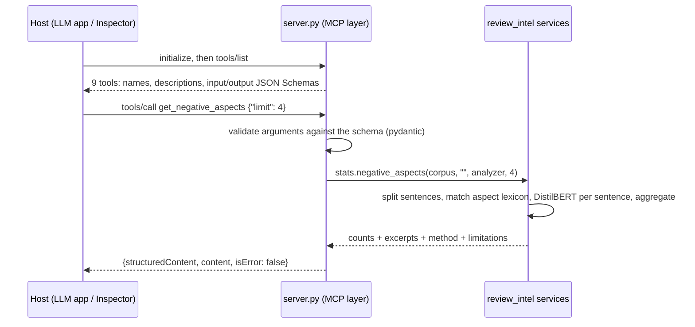

# Review Analyzer MCP (v2)

An **MCP server** that exposes the trained review-analysis system in [`../src/review_intel`](../src/review_intel) as tools for AI applications: Claude Desktop, Claude Code, MCP Inspector and agent frameworks.

This folder is **only the integration layer**. All NLP/ML logic (dataset pipeline, models, evaluation, aspect analysis, retrieval) lives in the `review_intel` package at the project root and works without MCP. See the [project README](../README.md) and the [methodology](../docs/research_methodology.md).

> **MCP is not the model.** MCP is a protocol (JSON-RPC 2.0 over stdio here) that standardizes how an AI application *discovers* tools (`tools/list`) and *calls* them (`tools/call`). It provides no LLM and does no sentiment analysis. The fine-tuned DistilBERT model, the statistics and the aspect analysis do the work; MCP carries requests and results.

## Tools

| Tool | Arguments | What it returns | Where its sentiment values come from |
|---|---|---|---|
| `analyze_sentiment` *(v1)* | `text` | label, class scores + **score type**, model version | **model prediction** (DistilBERT) |
| `get_review_statistics` *(v1)* | `product=""` | counts (integers) and percentages per label, average rating | **star-rating labels** |
| `search_reviews` *(v1)* | `keyword`, `product=""`, `limit=20` | reviews containing the keyword (`match_count` = all matches) | **star-rating labels** |
| `list_products` | `limit=20` | product ids, names, review counts, average rating, plus how many products have enough reviews | none |
| `get_product_summary` | `product` | counts, rating and sentiment distribution with 95% intervals, **sample-size check**, top and most-negative aspects, representative reviews | distribution: **star-rating labels**; aspects: **model prediction** |
| `get_negative_aspects` | `product=""`, `limit=5` | aspects ranked by negative mentions, with example excerpts and a sample-size check | **model prediction** (per sentence) |
| `compare_products` | `product_a`, `product_b` | side-by-side statistics with sample sizes, differences, shared aspects, `comparison_reliable` | distribution: **star-rating labels**; aspects: **model prediction** |
| `search_similar_reviews` | `query`, `product=""`, `limit=5`, optional `sentiment_filter`, `sentiment_source`, `candidate_pool` | reviews ranked by cosine similarity, optionally restricted to one sentiment | `sentiment`: **star-rating labels**; `predicted_sentiment` (only with `sentiment_source=model_prediction`): **model prediction** |
| `get_model_info` | none | active model, its validation **and test** metrics, corpus file and source, retriever, lexicon | none |

All tools are read-only (`readOnlyHint`). Their arguments are validated by JSON Schema; for example, `limit` has explicit minimum and maximum values. They return **structured output** with an `outputSchema`. There are no file-reading, shell or network tools.

### Star-rating labels vs model predictions

The two are **not interchangeable**, and every response says which one it contains in a `sentiment_sources` field (keyed by output field):

| `source` | Meaning |
|---|---|
| `star_rating_label` | The label stored in the corpus, derived from the review's star rating (1-2 negative, 3 neutral, 4-5 positive). The server checks this against the data: it is reported only when every review's label matches its rating. |
| `dataset_label` | A label stored in the corpus that is *not* derivable from a star rating, e.g. the hand-written labels of the 5-review demo file. |
| `model_prediction` | Predicted by the trained model; `model_version` names it. Its measured test metrics are in `get_model_info`. |
| `keyword_baseline_prediction` | Predicted by the keyword demo baseline, used only when explicitly configured. It is not a trained model. |

Example from `get_product_summary`:
```json
"sentiment_sources": {
  "sentiment_distribution": {"source": "star_rating_label", "model_version": null, "description": "…"},
  "most_negative_aspects": {"source": "model_prediction", "model_version": "distilbert@amazon_electronics-20261014-79b5c36e", "description": "…"}, …}
```

### Similar-review search with a sentiment filter

LSA similarity ranks by shared and co-occurring words. It does **not** understand negation or polarity: for "The battery drains too quickly." the top unfiltered hit on the per-product corpus (similarity 0.967) is a short review praising the battery (illustration, not the original text: [Synthetic review: "The battery runs for ages between charges."]).

`search_similar_reviews` therefore takes an optional, backward-compatible filter. The default `sentiment_filter="any"` returns exactly the previous results. The ranking is never changed; the filter only removes reviews.

| `sentiment_source` | What is filtered | Candidates |
|---|---|---|
| `star_rating_label` | The review's stored label from its **star rating**: what the customer rated, not necessarily what the text says | Every review (exact top-`limit`) |
| `model_prediction` | The sentiment model's prediction for the review **text**. Each result gets `predicted_sentiment` and `predicted_score`, and the response names the model version. | The `candidate_pool` most similar reviews (default 200, max 1,000). Fewer results than `limit` means the pool held fewer matches, and `note` says so. |

Rules:
- A filter needs an explicit `sentiment_source`.
- `sentiment_source` without a filter is an error.
- `star_rating_label` is refused on a corpus whose labels are not star ratings, such as the demo file.
- The stored label stays in `sentiment`, and model output goes to separate fields (`predicted_sentiment`, `predicted_score`), so the two are never mixed. `sentiment_sources` lists both.

Measured on the per-product corpus with DistilBERT on 2026-10-16 (top 5 of each). The queries are written for this project; review texts in the table are synthetic illustrations, not the original Amazon reviews.

| Query | Unfiltered | `negative` / `positive` + `star_rating_label` | same + `model_prediction` (pool 200) |
|---|---|---|---|
| "The battery drains too quickly." (negative) | 1 of 5 has a negative label; the top hit says the opposite | 5 of 5 are 1-2★ battery complaints | 5 of 5 predicted negative (44 of 200 in the pool). Includes a 4★ review whose text complains about the battery (e.g. [Synthetic review: "Nice screen, but I keep having to recharge it."]) |
| "The remote stopped working after two weeks." (negative) | 4 of 5 negative labels; one 5★ review that actually complains | Drops that 5★ complaint | Keeps it (predicted negative 0.949); 185 of 200 in the pool predicted negative |
| "Excellent battery life and reliable connection." (positive) | Includes a 3★ review naming the battery as its weak point (e.g. [Synthetic review: "The battery is the weak spot of this device."]) | Keeps a 4★ review with a battery complaint (e.g. [Synthetic review: "Good sound, though I wish it ran longer between charges."]) | Drops that one, but keeps a 5★ review whose text criticises the battery (e.g. [Synthetic review: "Love the design, but the charge runs out far too fast."]; predicted positive 0.962), a model error |

Neither source is ground truth. Star ratings describe the whole purchase; the model reads the text, with measured test macro-F1 0.7522 and neutral F1 0.45. The filter removes opposite-polarity results; it does not make the ranking understand meaning.

### Product-level analysis on the current corpus: limitations

The analytics corpus is the held-out **test split** of a random review sample. It was not collected per product, so most products have very few reviews:

| Fact (counted from `analytics_corpus.csv`) | Value |
|---|---|
| Reviews / products | 9,659 / 8,177 |
| Products with exactly 1 review | 7,369 |
| Products with ≥ 30 / ≥ 20 / ≥ 10 reviews | 1 / 7 / 17 |
| Most reviews for one product | 45 |
| Products with a name (title from the official metadata) | 25, covering 370 reviews |

What the tools do about it:
- `get_product_summary`, `compare_products` and `get_negative_aspects` return a `sample` block, `{"reviews", "min_reviews", "sufficient", "warning"}`. Below the threshold the warning says not to draw product-level conclusions.
- Product summaries add `sentiment_ci95`, the 95% Wilson interval of each percentage. `compare_products` adds `comparison_reliable` and `negative_percent_ci95_overlap`.
- The threshold is `REVIEW_ANALYZER_MIN_PRODUCT_REVIEWS`, default **30**. It is a rule-of-thumb heuristic, not a statistical guarantee.
- `list_products` reports how many products meet the threshold, have one review, or have a name.
- Products without a title have `product_name: ""` and are referred to by id. Names are never guessed.
- A name shared by several product ids is rejected rather than pooled. An exact id match wins over a name match, and comparing a product with itself (by id and by name) is rejected.

### Per-product corpus: real product-level analysis

For product summaries and comparisons, point the server at the **per-product corpus** collected on 2026-10-15:

```powershell
$env:REVIEW_ANALYZER_DATA = "data/processed/amazon_electronics_products/corpus.csv"
```

- **Contents:** 49,958 real reviews, 996–1,000 per product, for the 50 most-reviewed products. All 50 have official titles.
- **No overlap with the research sample:** none of these reviews were used for training or evaluation.
- **Thresholds:** all 50 products pass the 30-review threshold, and `list_products` reports `products_meeting_min_reviews: 50`.
- **How it was built:** see the project README, "Per-product corpus".
- **Defaults are unchanged:** the default corpus is still the held-out test split, and the tools' interfaces are the same.

Verified on that corpus over stdio with DistilBERT (2026-10-15), comparing Fire TV Stick `B075X8471B` (999 reviews) with Fire TV Stick 4K `B07GZFM1ZM` (1,000 reviews):
```json
{"comparison_reliable": true, "negative_percent_ci95_overlap": false,
 "differences": {"average_rating_a_minus_b": -0.19, "negative_percent_a_minus_b": 4.11, "positive_percent_a_minus_b": -4.71},
 "product_a": {"total_reviews": 999, "sentiment_ci95": {"negative": [8.39, 12.13], …}},
 "product_b": {"total_reviews": 1000, "sentiment_ci95": {"negative": [4.69, 7.65], …}}}
```
`get_negative_aspects` for `B075X8471B` (999 reviews; aspect sentiment from model predictions):

| Aspect | Reviews mentioning | Mentions | Negative share |
|---|---|---|---|
| remote | 92 | 138 | 0.297 |
| customer_service | 27 | 44 | 0.409 |
| battery | 29 | 36 | 0.389 |
| price | 77 | 89 | 0.157 |
| setup | 154 | 192 | 0.063 |

The aspect accuracy is still unmeasured (see the limitations below). 1,000 reviews per product is a uniform random sample of that product's reviews, not all of them.

## How a request flows



- **Expected failures** (empty text, unknown product, no trained model) raise `ToolError`. The client receives `isError: true` with a readable message such as *"Use list_products to see the available product ids and names"*, so the model can recover.
- **Unexpected exceptions** are logged with their traceback to **stderr**. The client gets only a generic error, so no internals leak (there's a test for this).
- **stdout is reserved for protocol messages.** The server never `print()`s.

## Setup (Windows PowerShell)

The server runs from the **project root virtual environment** (it imports `review_intel`):

```powershell
cd path\to\review-analyzer   # the project root
python -m venv .venv                 # once
.\.venv\Scripts\Activate.ps1
pip install -e ".[mcp,dev]"          # plus .[transformer] to serve the DistilBERT model
```

Then train and activate a model (see the project README), or explicitly choose the demo baseline, as described below.

## Configuration

Environment variables. Relative paths resolve from the **project root**, never from the current directory:

| Variable | Default | Meaning |
|---|---|---|
| `REVIEW_ANALYZER_DATA` | `data/processed/amazon_electronics/analytics_corpus.csv` | Review corpus: a processed `.csv` or a v1 `.json`. `demo` selects the 5-review demo file (below). |
| `REVIEW_ANALYZER_SENTIMENT_BACKEND` | `trained` | `trained`, or `keyword` (an explicit demo baseline; output then says `is_trained_model: false`) |
| `REVIEW_ANALYZER_MODEL_DIR` | from `artifacts/models/selected.json` | Serve a specific artifact |
| `REVIEW_ANALYZER_MAX_TEXT_CHARS` | `5000` | Maximum `analyze_sentiment` input |
| `REVIEW_ANALYZER_MIN_PRODUCT_REVIEWS` | `30` | Reviews a product needs before its summary or comparison stops being flagged as a small sample |
| `REVIEW_ANALYZER_RETRIEVER` | `lsa` | `lsa` (offline) or `sentence-transformers` (needs `.[semantic]`; downloads the model once) |
| `REVIEW_ANALYZER_ASPECTS` | `configs/aspects.json` | Aspect lexicon |

**The data source.**
- The real corpus is `data/processed/amazon_electronics/analytics_corpus.csv`. It holds 9,659 reviews: the held-out **test split**, not the whole dataset, plus product titles for 25 products. It is git-ignored and built with `scripts/build_corpus.py` (see the project README); its source is recorded in `analytics_corpus.json` and reported by `get_model_info`.
- Setting `REVIEW_ANALYZER_DATA` explicitly is recommended. The startup log on stderr says which file is used and whether it came from the variable or the default.
- **If the file does not exist, nothing falls back.** Every corpus tool returns `isError: true` with *"Review dataset not found: <path>. Set REVIEW_ANALYZER_DATA …"*, and the same message is logged at startup.
- **`review-analyzer-mcp/reviews.json`** (5 synthetic reviews) is for demonstration and tests only. It is used only with `REVIEW_ANALYZER_DATA=demo` (or its path), and the server then logs a DEMO warning.

> If no trained model exists and the backend is `trained`, the server **still starts**. The statistics and search tools work, while the sentiment and aspect tools return an actionable error: *"No model has been selected yet … Train one with: python scripts/train_baselines.py …"*. There is no silent fallback.

## Running the server

The server speaks MCP over **stdio**: the client launches it as a subprocess and exchanges JSON-RPC messages on its stdin/stdout. Logs go to stderr. Started by hand it waits silently for a client; that is expected, and you stop it with Ctrl+C.

```powershell
cd path\to\review-analyzer   # the project root
.\.venv\Scripts\Activate.ps1
$env:REVIEW_ANALYZER_DATA = "data/processed/amazon_electronics/analytics_corpus.csv"
python review-analyzer-mcp\server.py
```

In practice the MCP client starts the server itself (see [Connecting a real AI application](#connecting-a-real-ai-application)). It must use the root `.venv` Python and pass `REVIEW_ANALYZER_DATA` in its `env`.

## Performance

These are observations from one Windows 11 machine (RTX 5060, DistilBERT on CUDA), **not benchmarks**. They depend on hardware, disk and OS cache state, dataset size, other load on the machine and package versions.

| Step | Observed | When measured |
|---|---|---|
| DistilBERT load + warm-up at startup | 7.9 s and 18.3 s in two consecutive starts (the slower was the first, cold-cache start) | audit, 2026-10-15 |
| Server launch until `tools/list` answered (stdio) | 29.9 s (first start, analytics corpus); 9.6 s (second start, demo corpus) | audit, 2026-10-15 |
| First `search_similar_reviews` (builds the LSA index over 9,659 reviews), **before** the BLAS thread cap | 58.9 s in the server; 90.6 s in a standalone build. This exceeded the Inspector's default 60 s request timeout. | audit, 2026-10-15 |
| The same index build **after** capping BLAS threads at 4 (`LSA_BLAS_THREADS`; identical vectors, max difference 7e-13) | 13.4 s standalone. One Inspector CLI process (server start + model load + index build + query) took 27 s end to end. | 2026-10-15 |
| Later `search_similar_reviews` calls | about 0.08 s | 2026-10-14 session; not re-measured |
| First `get_negative_aspects` over the whole corpus (DistilBERT on every aspect sentence) | 11.2 s | 2026-10-14 session; not re-measured |
| Same call again (predictions memoized) | 1.1 s | 2026-10-14 session; not re-measured |
| Product-level tools for one product, statistics, keyword search (model already loaded) | 0.01-0.21 s | audit, 2026-10-15 |
| **Per-product corpus (49,958 reviews):** server start + `tools/list` | 9.5 s | 2026-10-15 |
| Per-product corpus: first `get_product_summary` / `compare_products` for a 1,000-review product (DistilBERT on its aspect sentences) | 3.0 s each; `get_negative_aspects` for the same product afterwards 0.1 s | 2026-10-15 |
| Per-product corpus: first `search_similar_reviews` (LSA index over 49,958 reviews, BLAS cap applied) | **48.9 s**. Close to the Inspector's 60 s default timeout, so raise the client timeout. | 2026-10-15 |

On 2026-10-14 the startup load was 4.0 s and the first LSA build 8.1 s. The 2026-10-15 audit saw much higher values on the same machine, which shows how much these numbers vary. For the LSA build, the main cause was found: BLAS thread oversubscription on this hybrid CPU (16 threads: 94 s, 8 threads: 54 s, 4 threads: 13 s for the same SVD). Expect the first call of each expensive kind to be slow, and give the client a request timeout of at least 120 s, or pass a `product` to restrict the work.

## Testing with MCP Inspector

`python server.py` alone just waits for a client on stdin. That's normal for stdio servers and does not prove anything works. Use the Inspector (Node.js 22.19+ required):

```powershell
cd path\to\review-analyzer   # the project root
# Web UI (opens a browser at http://127.0.0.1:6274?MCP_INSPECTOR_API_TOKEN=...)
npx @modelcontextprotocol/inspector -e REVIEW_ANALYZER_DATA=data/processed/amazon_electronics/analytics_corpus.csv `
    "$PWD\.venv\Scripts\python.exe" review-analyzer-mcp\server.py

# CLI mode (scriptable): list tools, call one
npx @modelcontextprotocol/inspector --cli "$PWD\.venv\Scripts\python.exe" review-analyzer-mcp\server.py --method tools/list
npx @modelcontextprotocol/inspector --cli -e REVIEW_ANALYZER_DATA=data/processed/amazon_electronics/analytics_corpus.csv `
    "$PWD\.venv\Scripts\python.exe" review-analyzer-mcp\server.py `
    --method tools/call --tool-name get_negative_aspects --tool-arg limit=4
```

In the web UI: check that the transport is **STDIO** and the command and arguments are pre-filled, click **Connect**, open **Tools**, click **List Tools**, choose a tool, fill in the arguments and click **Run Tool**. The CLI exits with code 5 when a tool returns `isError: true`, which is expected for error examples.

**Verified on 2026-10-14** with Inspector 2.11.0 CLI mode: all 9 tools were discovered, and every example below is a real response from the server running the selected DistilBERT model on CUDA. The browser click-through was not exercised in this session.

## Example calls (real responses, abbreviated with "…")

Review texts in this section are synthetic placeholders written for this documentation (labelled `[Synthetic example]`); the original Amazon review texts are not reproduced. All other values (ids, ratings, scores, similarities, counts) are from the real responses and were computed on the original texts.

These responses were captured on 2026-10-14, before `sentiment_sources`, `sample`, `sentiment_ci95`, `comparison_reliable` and the `list_products` coverage fields were added. Those fields now appear in addition to everything shown here; see the excerpt captured after the change at the end of this section.

**`analyze_sentiment`**: `text = "Setup was easy but the remote stopped working after a week."`
```json
{
  "sentiment": "negative",
  "method": "distilbert",
  "scores": {"negative": 0.720872, "neutral": 0.268813, "positive": 0.010316},
  "score_type": "softmax_probability",
  "score_description": "Softmax over the transformer's output logits. They sum to 1 but fine-tuned transformers are often over-confident; see the ECE in the evaluation report before reading them as probabilities.",
  "model_version": "distilbert@amazon_electronics-20261014-79b5c36e",
  "is_trained_model": true,
  "warning": "Prediction from trained model distilbert@amazon_electronics-20261014-79b5c36e. Trained on star-rating-labelled reviews; accuracy outside that domain is unknown. See get_model_info for measured metrics.",
  "positive_matches": [], "negative_matches": [], "text": "…"
}
```

**`get_model_info`** (excerpt): `status: "ready"`, model `distilbert` on `cuda`, and test metrics for exactly this version:
```json
{"split": "test", "n": 9659, "accuracy": 0.8927, "macro_f1": 0.7522,
 "per_class_f1": {"negative": 0.8493, "neutral": 0.4513, "positive": 0.9559}, "role": "selected"}
```

**`list_products`**: `limit = 5` (analytics corpus)
```json
{"corpus": "analytics_corpus.csv", "total_reviews": 9659, "products": [
  {"product": "B075X8471B", "product_name": "Fire TV Stick with Alexa Voice Remote, streaming media player - Previous Generation", "review_count": 45, "average_rating": 4.533},
  {"product": "B01K8B8YA8", "product_name": "Echo Dot (2nd Generation) - Smart speaker with Alexa - White", "review_count": 27, "average_rating": 4.111}, …]}
```

**`get_product_summary`**: `product = "B01K8B8YA8"` (Echo Dot 2nd Gen)
```json
{
  "total_reviews": 27, "average_rating": 4.111,
  "rating_distribution": {"1": 4, "2": 2, "3": 0, "4": 2, "5": 19},
  "sentiment_distribution": {"positive": {"count": 21, "percent": 77.78}, "negative": {"count": 6, "percent": 22.22}, "neutral": {"count": 0, "percent": 0}},
  "most_mentioned_aspects": [
    {"aspect": "setup", "reviews_mentioning": 5, "mentions": 11, "sentiment_counts": {"positive": 8, "neutral": 1, "negative": 2}, "negative_share": 0.1818},
    {"aspect": "sound", "reviews_mentioning": 5, "mentions": 8, "sentiment_counts": {"positive": 4, "neutral": 2, "negative": 2}, "negative_share": 0.25}, …],
  "representative_reviews": {"negative": [{"review_id": 56843, "rating": 1, "text": "[Synthetic example] Would not connect to my other speakers. Disappointed. …"}], …},
  "method": {"aspects": {"description": "Dictionary-based aspect extraction …", "limitations": ["Lexicon matching, not a trained aspect extractor …", …]}}
}
```

**`get_negative_aspects`**: `limit = 4`, whole corpus (9,659 reviews)

| aspect | mentions | positive / neutral / negative | negative share |
|---|---|---|---|
| battery | 1,644 | 910 / 385 / 349 | 0.212 |
| price | 2,483 | 1,786 / 375 / 322 | 0.130 |
| customer_service | 827 | 381 / 145 / 301 | 0.364 |
| sound | 2,194 | 1,365 / 531 / 298 | 0.136 |

Each aspect comes with evidence excerpts, e.g. `{"review_id": 43321, "excerpt": "[Synthetic example] The battery dies too fast.", "matched_term": "battery", "score": 0.99359}`.

**`compare_products`**: `B075X8471B` (Fire TV Stick, 45 reviews) vs `B07GZFM1ZM` (Fire TV Stick 4K, 23 reviews)
```json
{"differences": {"average_rating_a_minus_b": 0.185, "negative_percent_a_minus_b": -6.37, "positive_percent_a_minus_b": 8.41},
 "shared_aspects": [{"aspect": "setup", "a": {"mentions": 10, "negative_share": 0}, "b": {"mentions": 8, "negative_share": 0}, …},
                    {"aspect": "remote", "a": {"mentions": 4, "negative_share": 0.75}, "b": {"mentions": 2, "negative_share": 0}, …}],
 "notes": ["Differences are descriptive statistics over this corpus, not significance-tested.", "Small review counts make percentages unstable; …"]}
```
Read the counts before the percentages: "remote" has only 4 vs 2 mentions here.

**`search_similar_reviews`**: `query = "remote stopped working after a few weeks"`, `limit = 3`
```json
{"method": "lsa (tf-idf + truncated SVD, 200 dims, cosine)", "results": [
  {"id": 96889, "text": "[Synthetic example] The remote quit working a few months after purchase.", "rating": 1, "similarity": 0.9381},
  {"id": 70915, "text": "[Synthetic example] Stopped responding; I would like a refund.", "rating": 1, "similarity": 0.8909},
  {"id": 55465, "text": "[Synthetic example] Worked for a short while, then died.", "rating": 1, "similarity": 0.8813}]}
```

**Error example**: `get_product_summary` with `product = "iPhone 99"` → `isError: true`, *"No reviews found for product 'iPhone 99'. Use list_products to see the available product ids and names."*

**After the 2026-10-15 fixes** (real Inspector CLI responses, DistilBERT, analytics corpus, abbreviated):

`list_products` (`limit = 2`) now starts with corpus coverage:
```json
{"total_reviews": 9659, "products_in_corpus": 8177, "products_with_one_review": 7369, "products_with_name": 25,
 "min_reviews_for_summary": 30, "products_meeting_min_reviews": 1, "max_reviews_per_product": 45,
 "notes": ["8176 of 8177 products have fewer than 30 reviews; their summaries and comparisons are flagged as small samples.",
           "8152 products have no product_name in this corpus (no title available); refer to them by product id. Names are never guessed."], "products": […]}
```

`get_product_summary` for `B01M30H97J`, a product with one review and no name:
```json
{"product": "B01M30H97J", "product_name": "", "total_reviews": 1,
 "sentiment_distribution": {"positive": {"count": 1, "percent": 100}, "negative": {"count": 0, "percent": 0}, …},
 "sentiment_ci95": {"positive": [20.65, 100], "negative": [0, 79.35], "neutral": [0, 79.35]},
 "sample": {"reviews": 1, "min_reviews": 30, "sufficient": false,
            "warning": "Small sample: this summary describes a single review, not the product (threshold 30). …"},
 "notes": ["Small sample: …", "No product name is available for this product in the corpus; it is identified by id only."], …}
```

`compare_products`, `B075X8471B` (45 reviews) vs `B01K8B8YA8` (27 reviews):
```json
{"comparison_reliable": false, "negative_percent_ci95_overlap": true,
 "notes": ["B01K8B8YA8 has only 27 review(s) (threshold 30); the comparison is not meaningful for it.",
           "The 95% intervals of the negative percentages overlap, so this corpus does not show a clear difference in negative share.", …]}
```

`get_review_statistics` counts are now integers: `{"positive": 7258, "negative": 1744, "neutral": 657}`, with `sentiment_sources.counts.source = "star_rating_label"`.

## Connecting a real AI application

Any MCP client that supports **stdio** servers needs the same three things:
- the **command**: the root `.venv` Python (absolute path);
- the **arguments**: the absolute path of `server.py`;
- the **environment**: `REVIEW_ANALYZER_DATA`.

The client starts the process itself, so nothing needs to be running beforehand.

**Claude Code** (from the project root). This syntax was checked against `claude mcp add --help` of Claude Code 2.1.300: `claude mcp add [options] <name> <commandOrUrl> [args...]`, with `-e KEY=value` and stdio as the default transport.
```powershell
claude mcp add review-analyzer -e REVIEW_ANALYZER_DATA=data/processed/amazon_electronics/analytics_corpus.csv `
    -- "$PWD\.venv\Scripts\python.exe" "$PWD\review-analyzer-mcp\server.py"
```

**Claude Desktop** (`claude_desktop_config.json`, then restart the app). This uses the standard `mcpServers` → `command` / `args` / `env` format; it has not been tested with Claude Desktop in this project:
```json
{
  "mcpServers": {
    "review-analyzer": {
      "command": "C:\\path\\to\\review-analyzer\\.venv\\Scripts\\python.exe",
      "args": ["C:\\path\\to\\review-analyzer\\review-analyzer-mcp\\server.py"],
      "env": {"REVIEW_ANALYZER_DATA": "data/processed/amazon_electronics_products/corpus.csv"}
    }
  }
}
```

Replace `C:\\path\\to\\review-analyzer` with the absolute path of your clone.

**Startup timeout.** The server loads DistilBERT before it answers the MCP handshake. On the development machine the handshake took 8.5 s with a warm disk cache (2026-10-16) and about 30 s on a cold start (audit, 2026-10-15). A cold start can therefore hit Claude Code's MCP startup timeout. If `/mcp` reports a connection timeout, start Claude Code with a larger limit, e.g. `$env:MCP_TIMEOUT = "120000"; claude` (milliseconds).

Then ask, for example: *"Which aspects of the Fire TV Stick (B075X8471B) do customers complain about? Show evidence, and say how many reviews this rests on."* Ask about products from the top of `list_products`; for most products the corpus holds one review.

## Tests

From the project root, with the root `.venv` active:

```powershell
python -m pytest review-analyzer-mcp/tests     # MCP layer only
python -m pytest                               # everything (research system + MCP)
```

- `test_server.py`: the **original 35 v1 tests**.
  - Two assertions changed, from "exactly 3 tools" to "the 3 v1 tools are still present".
  - `conftest.py` pins them to the explicit keyword backend and the explicit demo corpus (`REVIEW_ANALYZER_DATA=demo`), so they don't depend on local training runs.
  - Their stdio test now passes `REVIEW_ANALYZER_DATA=demo` to the subprocess, because the demo file is no longer the default.
- `test_server_v2.py`: covers
  - discovery and schemas of all 9 tools;
  - valid calls with a model trained on the synthetic fixture;
  - invalid arguments and `ToolError` messages;
  - no leaking of internals and missing-model behavior;
  - a real **stdio subprocess** session with environment configuration.
- `test_server_fixes.py`: covers
  - data-path resolution: the default, `demo`, and paths relative to the project root from another working directory;
  - a missing data file for every corpus tool and over stdio;
  - integer counts in values and in the output schema;
  - `sentiment_sources` in every tool;
  - one-review and unnamed products, insufficient vs sufficient comparisons, and a product compared with itself;
  - the configurable threshold.

## Troubleshooting

| Symptom | Fix |
|---|---|
| `review_intel is not importable` on stderr | Run with the root `.venv` Python after `pip install -e ".[mcp]"`. The old `review-analyzer-mcp\.venv` does not have it. |
| `analyze_sentiment` → "No model has been selected yet" | Train and `evaluate_models.py compare --activate`, set `REVIEW_ANALYZER_MODEL_DIR`, or set `REVIEW_ANALYZER_SENTIMENT_BACKEND=keyword` for the demo baseline. |
| "needs the optional transformer dependencies" | The selected model is DistilBERT: install `torch` and `pip install -e ".[transformer]"`. |
| "Review dataset not found: …" | Build the corpus (`scripts/build_corpus.py`, project README), or point `REVIEW_ANALYZER_DATA` at an existing file. Relative paths are taken from the project root. Use `REVIEW_ANALYZER_DATA=demo` for the 5-review demo. |
| `get_review_statistics` reports 5 reviews | You are on the demo corpus (`REVIEW_ANALYZER_DATA=demo`); `get_model_info` → `corpus.is_demo` says so. |
| First `get_negative_aspects` / `search_similar_reviews` / server start is slow or times out | Expected cold-start work (see [Performance](#performance)): the model load, DistilBERT over every aspect sentence, and building the LSA index. Later calls are fast. Raise the client's request timeout, or pass a `product`. |
| Product not found | Call `list_products`. Products are matched by exact id or exact name, case-insensitively; an id match wins, and a name shared by several ids is rejected. |
| `sample.sufficient: false` | The product has fewer reviews than `REVIEW_ANALYZER_MIN_PRODUCT_REVIEWS` (default 30). The numbers are real but too few to generalize from. |
| JSON parse errors in the client | Something wrote to stdout. Use `logging`, which goes to stderr. |
| Inspector: port 6274 in use / auth error | Close the old Inspector. Open the full printed URL, including `MCP_INSPECTOR_API_TOKEN`. |

## Limitations (integration layer)

- On the default corpus (the held-out split), product analytics rest on small per-product samples: at most 45 reviews, and only 1 product reaches the threshold of 30. Use the [per-product corpus](#per-product-corpus-real-product-level-analysis) for product questions. It covers 50 popular products only, and other products are not in it.
- The `sample` check counts **reviews**, not aspect mentions. A product with enough reviews can still have an aspect mentioned only twice, so read `mentions` before `negative_share`.
- Wilson intervals describe sampling uncertainty only. They do not correct for label noise in star ratings or for model errors in the aspect sentiment.
- Aspect sentiment is lexicon matching plus sentence-level predictions from a review-level model. Its accuracy is unmeasured; every result carries this caveat in `method.limitations`.
- The corpus is loaded from a local file and cached by modification time. There is no database, by design, at this scale.
- After retraining or reactivating a model, restart the server so it picks up the new model.
